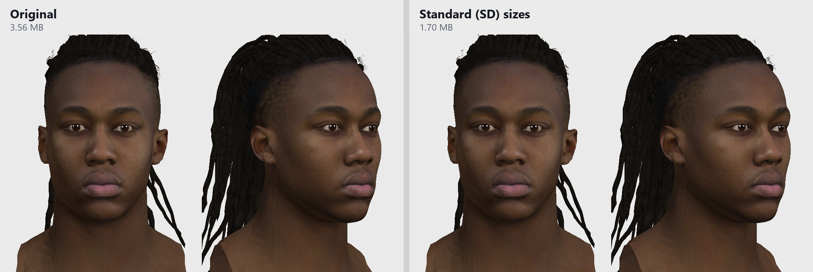
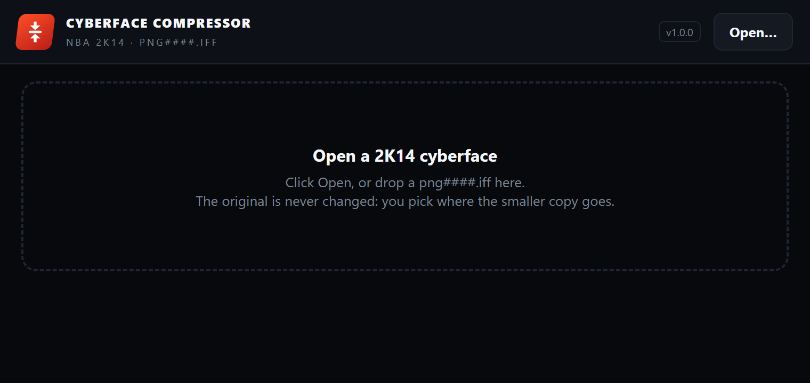
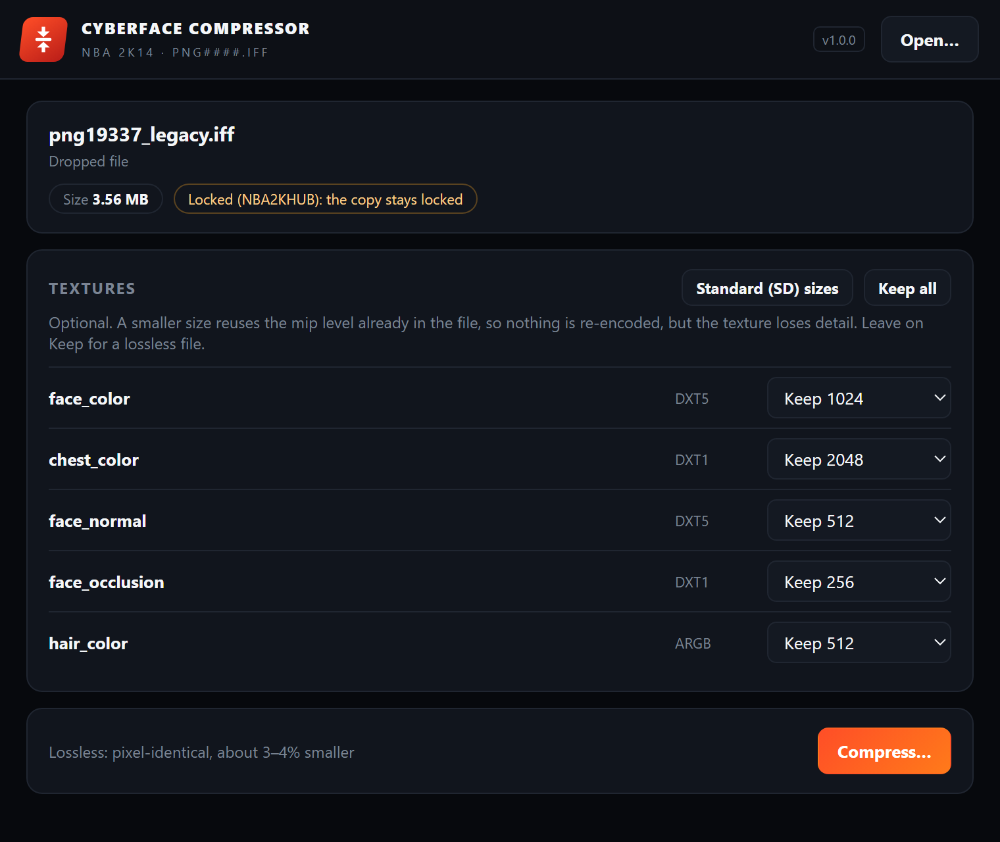
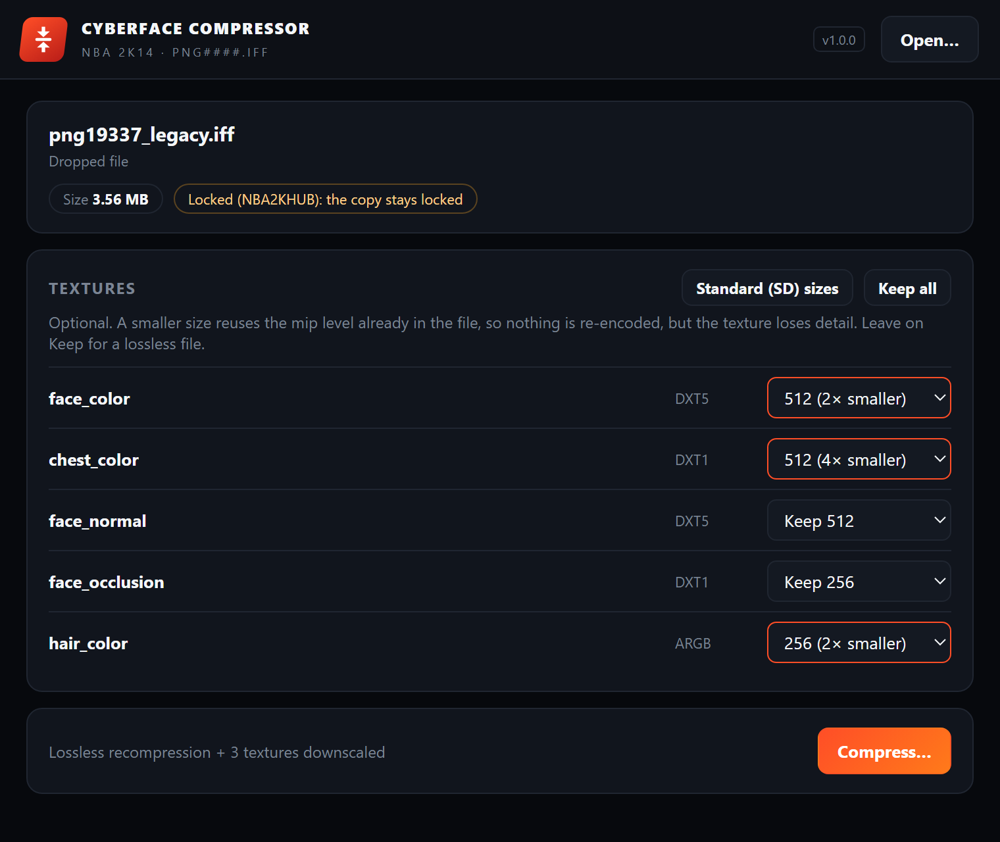
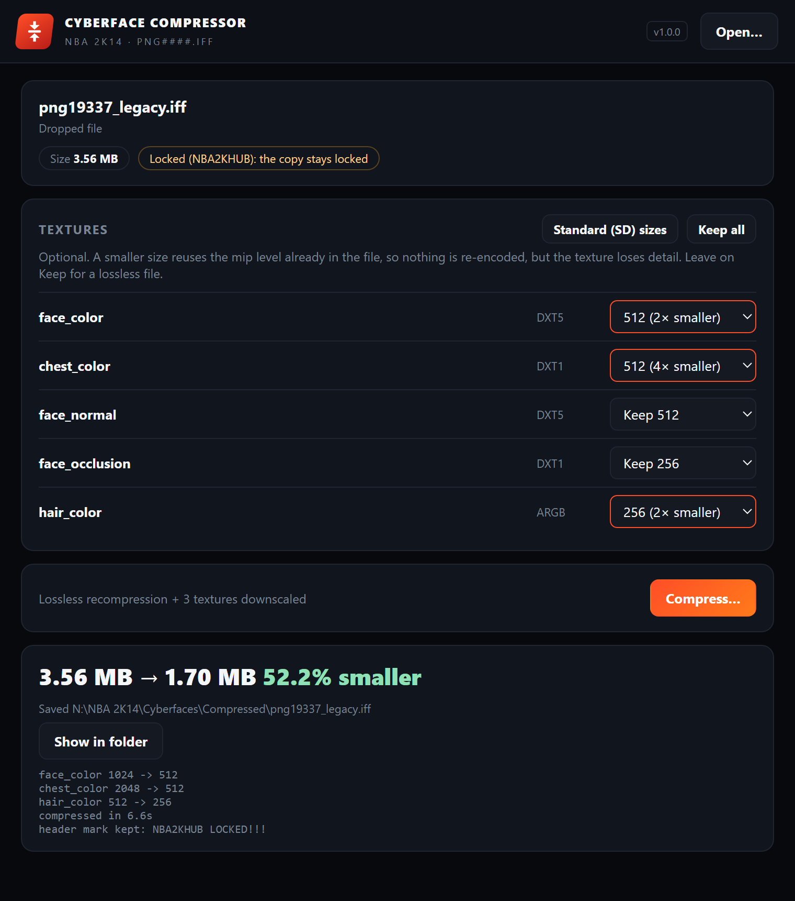

# Cyberface Compressor

Make NBA 2K14 cyberfaces (`png####.iff`) smaller, so big HD faces load faster and take less space.

- **Lossless**: every file gets about 3-4% smaller with no change at all to what the game reads.
- **Standard (SD) sizes** in one click: HD faces often get **50-90% smaller**.
- Works on **locked** (NBA2KHUB IFF Locker) and **RED MC** files. The smaller copy stays locked.
- Your original file is **never changed**. The tool always saves a new copy.



*A legacy HD face before and after "Standard (SD) sizes": 3.56 MB down to 1.70 MB.*

## Download

1. Go to [**Releases**](https://github.com/BlueCode10/cyberface-compressor/releases/latest) and download `CyberfaceCompressor-1.0.0.zip`.
2. Unzip it anywhere. Keep `CyberfaceCompressor.exe` next to the `_internal` folder.
3. Run `CyberfaceCompressor.exe`.

You need Windows 10 or 11 with Microsoft Edge, which is already installed on most PCs. Python is not needed.

> Windows may show "Windows protected your PC" the first time, because the exe isn't signed. Click **More info**, then **Run anyway**.

## How to use

### 1. Open a cyberface

Click **Open...**, or drag a `png####.iff` onto the window. You can also drop it onto `CyberfaceCompressor.exe`.



### 2. Check the textures

The window shows the file size, whether the file is locked, and each texture with its current size.



### 3. Pick the sizes

- **Leave everything on "Keep"** for a lossless file. It looks exactly the same in game, only smaller.
- **Click "Standard (SD) sizes"** to set the stock NBA 2K14 sizes in one click:

  | Texture | SD size |
  |---|---|
  | face_color | 512 |
  | chest_color | 512 |
  | face_normal | 512 |
  | face_occlusion | 256 |
  | hair_color | 256 |

  Textures that are already that size or smaller stay as they are.
- Or **pick any size yourself** for each texture.
- **Keep all** puts everything back on Keep.



### 4. Compress

Click **Compress...** and choose where to save. By default the copy goes into a `Compressed` folder next to the original, with the same file name, so it's ready to copy into the game. It takes about 10-40 seconds.



Click **Show in folder** to find the new file. Then copy it into your NBA 2K14 folder, replacing the old one. Keep a backup of the original.

## FAQ

**Will it look worse in game?**
Not when every texture is on Keep; that file is lossless. Smaller texture sizes do lose some detail, which you'll mostly notice up close (see the picture above). SD sizes are the sizes the game's own faces use.

**Does it re-encode the textures?**
No. Every texture already contains smaller copies of itself (mipmaps). Downscaling just makes the smaller copy the main one, so there's no extra blur or compression artifacts.

**My file is locked. Do I need to unlock it first?**
No. Locked files are opened as they are, and the compressed copy is locked again the same way.

**Why can't I resize one of the textures?**
A texture that isn't square with a full set of mipmaps (for example a 512x128 hair) is kept as it is. The other textures can still be resized.

**Is it safe?**
After writing the copy, the tool reads it back and checks it. The lossless part must match the original byte for byte, and the head mesh and other data must be untouched. If any check fails, you get an error instead of a broken file.

## Command line

```
python compressor.py png1013.iff                          # lossless, saved to Compressed\png1013.iff
python compressor.py png1013.iff --chest_color 512 --hair_color 256 -o small\png1013.iff
```

## Build from source

Needs Python 3 with `numpy`, `zopfli` and `pyinstaller`:

```
pip install numpy zopfli pyinstaller
build.bat
```

| File | What it does |
|---|---|
| `app.py` | Local server (127.0.0.1 only) and the Microsoft Edge app window |
| `index.html` | The window |
| `compressor.py` | The compression itself (also a command-line tool) |
| `lockfmt.py` | Reads and restores the locked / RED MC header layout |
| `make_icon.py` | Draws `icon.ico` (needs pillow) |
| `lib/` | NBA 2K14 .iff readers (iff2k, layout, meshio) |
